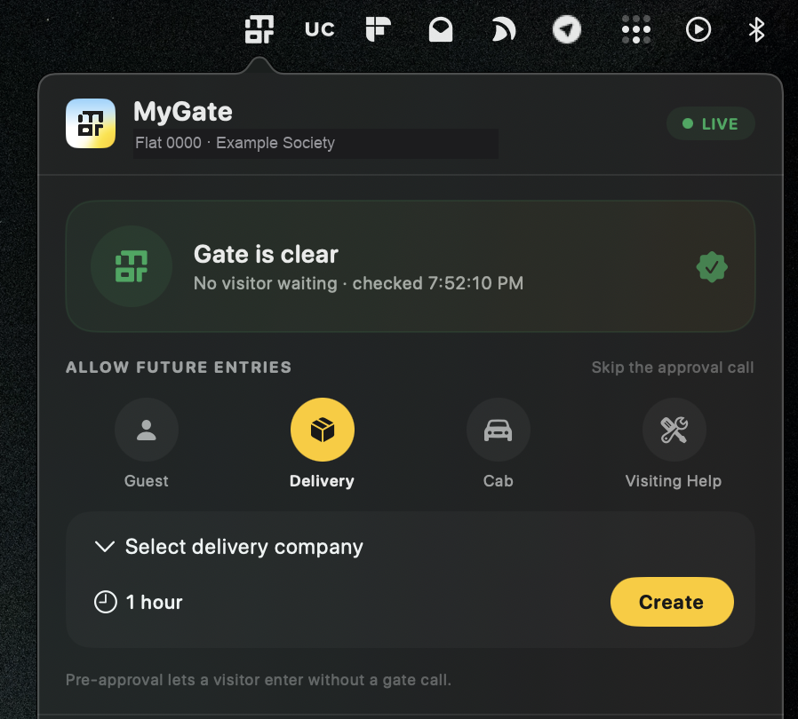

# MyGate MenuBar

A small macOS menu bar app for MyGate residents. It shows pending visitor approvals at the gate
and lets you approve or deny them without opening the phone app.

## Features

- Live pending approval check, refreshed every two seconds.
- Visitor popup with the gate photo, visitor type, gate and flat details.
- Approve or deny with one click.
- Recent visitor history: who is inside now, plus a scrollable three-day log.
- The log imports MyGate's own activity feed, so it matches what the phone shows.
- Pre-approvals: delivery company (including an "Others (any delivery)" option), cab, guest invite and visiting help.
- Cancel guest passes and pre-approvals from History.
- Branded menu bar icon and popover.

## How it works

The app uses the same endpoints as the MyGate Android app:

- Login: OTP request and login, then the returned `access-key` header.
- Pending approval: `GET /notif/v2/validation/active`.
- Approve/Deny: the `replyto` URL from the pending notification
  (`/acknowledge/v1/notification/validation`) with `valstatus: A` or `D`.
  The older `/ecom/v3/approvalrequest/*` routes remain as a fallback.
- Pre-approval lists and requests.
- Visitor history: `GET /flat/v2/visitors` and `GET /seekinvite/v1/myvisits`.

Polling replaces push notifications, because the phone app's FCM channel is not available on macOS.

## Who can use it

Any MyGate resident. The app has no hard-coded user, flat or society. Log in with your own
phone number and OTP; the session is stored only on your Mac.

## Setup

1. Build and install:

        ./build.sh
        cp -R "Build/MyGate MenuBar.app" ~/Applications/
        open "$HOME/Applications/MyGate MenuBar.app"

2. Enter the phone number and the OTP in the app. The access key is stored in the macOS
   Keychain (service `io.github.anand1996aditya.mygate-menubar`, account `access-key`). The remaining, non-secret
   settings are stored at `~/Library/Application Support/MyGateMenuBar/config.json` with
   `0600` permissions. `config.json` never contains the access key.

No credentials are compiled into the binary.

Existing installs migrate automatically on first launch. If an older `config.json` still
contains an `apiKey`, the app moves it to the Keychain, blanks the field in the JSON and keeps
every other setting. If the Keychain write fails, the old JSON copy is kept so the session still
works, and migration retries on the next launch.

## Privacy

The repository contains no API keys, session tokens, phone numbers or personal photos.
The access key is kept in the macOS Keychain on your Mac. Non-secret settings and diagnostics
stay in Application Support, and diagnostics are owner-only (`0600`).

## Limits

- Read-only for door locks. The app only handles gate approvals.
- No push notifications. Polling is the alerting mechanism.
- Approval and deny calls act on real visitor requests.

## License

MIT. See `LICENSE`.
